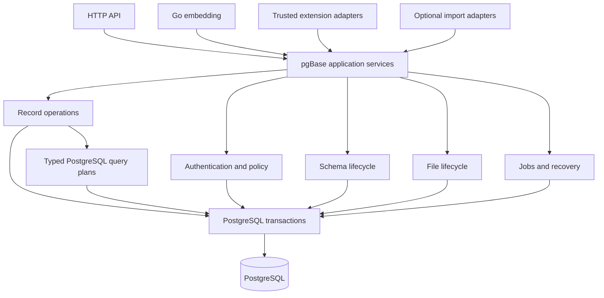

# PostgreSQL 기반 백엔드 재설계

pgBase는 PostgreSQL 기반의 독립 제품이다. PocketBase는 제품 사용 경험을 검토하는 참고 사례이며 내부 구조, SQLite 동작, HTTP 형식, 확장 API의 설계 규격이 아니다. 다른 제품의 데이터 가져오기는 핵심 레코드 엔진과 분리된 선택 기능으로 다룬다.

이 문서는 선행 구현의 기록이다. 이후 백엔드 전체 실행 계획에 따라 트랜잭션·조회·스키마·권한·파일·비동기 처리·앱 조립·확장·지원 서비스와 호출자를 재구성했다. 최종 구현 범위와 통합 검증은 [백엔드 재작성과 통합 검증](backend-rewrite-validation.md)을 따른다. 운영 배포와 릴리스는 별도다.

전체 구현 순서·에이전트별 파일 소유권·선행 의존·최종 완료 기준은 [백엔드 전체 재설계 실행 계획](backend-redesign-plan.md)을 따른다. 현재 목표는 백엔드 전체를 새 구조로 재작성하며 중복·불필요한 코드와 결합을 정리하는 것이다. 성능 측정·튜닝은 후순위이며 재작성 착수나 완료의 선행 조건이 아니다.

## 목표 구조



서비스와 쿼리 엔진은 pgBase의 데이터·권한·일관성 계약을 소유한다. HTTP와 확장 어댑터는 입력을 해당 계약으로 변환한다. 외부 제품의 이름이나 호출 형식이 내부 모델을 결정하지 않게 한다. 이 그림은 목표 의존 방향이며, 기존 호환 처리의 패키지 분리가 모두 끝났다는 뜻은 아니다.

## 적용한 변경

| 영역 | 이전 경로 | 현재 구현 |
| --- | --- | --- |
| 정확한 레코드 집계 | 200개씩 목록을 읽고 커서·응답·관계를 구성하며 합산 | 목록과 같은 권한·필터 계획으로 SQL 집계 실행 |
| 조회 계획 | 목록과 집계에서 권한·관계·정책 구성을 중복 | `query.planRead`를 공유하고 실행 방식만 분리 |
| 트랜잭션 전달 | 레코드 쓰기 패키지만 호출자 트랜잭션을 인식 | `database`의 트랜잭션 컨텍스트를 조회·쓰기에서 공유 |
| 조회와 ID 변환 | 조회가 끝난 뒤 다른 카탈로그·연결로 외부 ID 변환 | ID 해석, 조회, 응답 ID 변환을 한 트랜잭션 안에서 완료 |
| 텍스트 ID 응답 | 루트·관계·확장 대상마다 개별 조회 | 요청의 중복 ID를 모아 한 번의 집합 조회로 변환 |
| 규칙 저장 | 표현식은 호환 API, 소유자 규칙 복원은 두 번째 요청 | 기본 API에서 표현식과 typed 규칙을 함께 파싱하고 한 정책으로 저장 |
| 규칙 내부 모델 | PocketBase 이름의 AST 원문·컴파일러·피연산자 | pgBase 표현식 원문·컴파일러·피연산자 모델 |
| 이전 규칙 데이터 | `pocketbase` 원문 키 | 읽을 때 `expression`으로 해석하며 새 응답과 저장은 기본 이름 사용 |
| 목록 호환 코드 | 기본 조회 서비스 파일에 페이지 어댑터 구현 | `query/compatibility.go`에 기존 어댑터를 모음; 패키지 분리는 후속 작업 |

호출자가 빌려준 트랜잭션은 조회 서비스가 커밋하거나 재시도하지 않는다. 직접 연 트랜잭션만 소유자가 재시도한다. 목록과 집계는 같은 권한 검사를 사용하고, 숨겨진 필터·정렬 피연산자 검사와 관계 대상 정책을 유지한다. 기본 커서 페이지네이션과 선택적 bounded total도 유지한다.

## 기본 규칙 API

`PUT /api/admin/collections/{collection}/rules`는 기존 typed AST와 다음 표현식 입력을 한 정책에서 받는다. 관리자 인증·Origin·CSRF 요구사항은 동일하다.

```json
{
  "rules": {
    "list": { "op": "expression", "expression": "published = true" },
    "view": { "op": "owner" },
    "create": { "op": "authenticated" },
    "update": { "op": "owner" },
    "delete": { "op": "deny" }
  }
}
```

서버는 표현식을 typed AST로 파싱하고 전체 정책을 검증한 뒤 저장한다. 빈 표현식은 허용하지 않으며 전체 공개는 명시적인 `allow`로 설정한다. 잘못된 표현식에는 `rules.<action>`과 가능한 경우 `rules.<action>.position` 오류를 반환한다. 관리자 UI도 기본 API를 사용한다.

이전 `pocketbase` 키로 저장된 AST는 계속 읽을 수 있다. 같은 규칙에 `expression`과 `pocketbase`가 동시에 들어오면 모호한 입력으로 거부한다. 기존 명시적 `?compat=pocketbase` 경로는 남아 있다. DB 마이그레이션은 추가하지 않았다. 기본 규칙 API의 원문 필드를 직접 사용하는 클라이언트는 새 `expression` 키에 맞춰야 한다.

## 선행 구현 당시의 후속 범위

| 영역 | 완료 조건 |
| --- | --- |
| 앱 조립과 생명주기 | 자원 소유·시작·실패 정리·종료 순서를 한 곳에서 정의하고 초기화 실패와 종료 회귀 통과 |
| 인증과 세션 | 관리자·사용자·realm의 공통 정책과 각 신뢰 경계를 명시하고 로그인·취소·폐기·MFA·OAuth 회귀 통과 |
| 스키마 변경 | PostgreSQL 타입·제약·인덱스·잠금 기준으로 설계하고 기존 데이터 검증과 업그레이드·복원 시험 통과 |
| 파일과 백그라운드 처리 | DB와 외부 저장소의 실패·재시도·삭제 계약을 정리하고 장애 복구와 중복 실행 시험 통과 |
| 확장과 이전 기능 | 기존 JavaScript 전역·필터·페이지·validation mode 호환 처리를 목록화하고 pgBase 기능과 선택 어댑터의 실제 의존 분리 |
| 성능 인수 | 대표 데이터에서 쿼리 수·메모리·실행 계획·동시성·지연 측정, 변경 전후 수치와 회귀 기준 확정 |
| 출시 | 전체 PostgreSQL 지원 matrix, SDK, 브라우저, 파일 저장소, 복원·업그레이드 검증 후 별도 릴리스 |

위 표는 선행 구현 당시의 후속 작업이다. 최종 처리와 검증 근거는 재작성 검증 문서에 기록했다. 기존 동작을 임의로 삭제하거나 새 디렉터리로 이동하는 것만으로 재설계를 완료했다고 판단하지 않는다. PostgreSQL에서 검증 가능한 일관성과 비용 개선을 완료 기준으로 삼는다.

## 회귀 검증

추가한 회귀는 401개 레코드의 집계가 레코드 목록을 읽지 않고 집계 SQL 한 번으로 처리되는지, 250개 루트의 관계·확장 ID 변환이 집합 조회 한 번으로 끝나는지, 호출자 트랜잭션의 미커밋 텍스트 ID 레코드가 조회·목록·집계에서 보이고 롤백 뒤 사라지는지 확인한다. UUID 컬렉션의 ID 응답은 identity 테이블을 조회하지 않는지도 확인한다.

규칙 API 회귀는 표현식과 소유자 규칙의 단일 저장, 잘못된 표현식의 무변경 실패, 이전 원문 키 읽기, 알 수 없는 중첩 필드와 중복 원문 키 거부를 확인한다. UI 회귀는 단일 요청 저장과 실패 시 편집 내용 보존을 확인한다.

검증한 항목은 Go 전체 단위 테스트와 skip 정책 검사, `go vet ./...`, 프로젝트 Go 린트, PostgreSQL 17.11의 recordops·recordidentity·query·recordaccess·realtime·userauth 전체 통합/race 검사, 앱의 트랜잭션·레코드 규칙·schema transfer·realtime HTTP 회귀, 새 기본 규칙 API의 HTTP 저장·필터·실패 원자성 회귀다. 관리자 UI는 타입 검사·183개 테스트·내장 번들 빌드를 통과했다. PostgreSQL 16/18 matrix, 전체 브라우저 E2E, S3·복원·배포 인수는 이번 실행에 포함하지 않았다.
