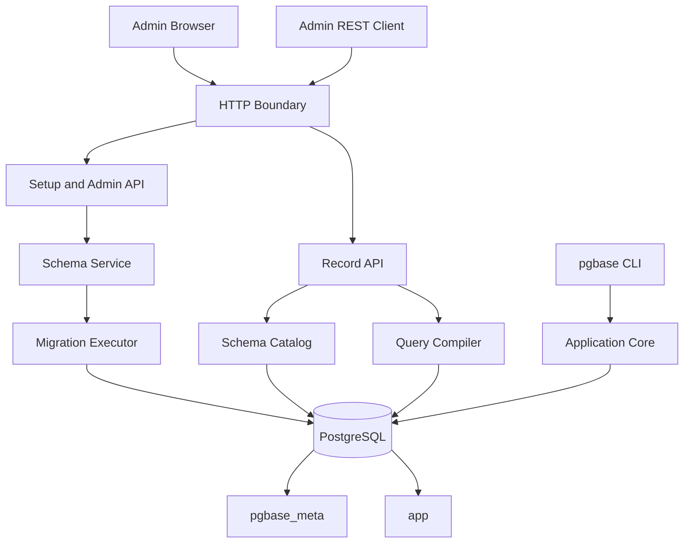

# pgBase Production Kernel 설계

- 상태: 승인된 설계
- 작성일: 2026-08-28
- 기준 문서: [pgBase — 제품 기획서 (v0.1 초안)](https://app.notion.com/p/3c9d9bc767f081ce8934e9cd22bdc85b)
- 대상 단계: v0.1의 첫 번째 수직 구현 단위

## 1. 목적

Production Kernel은 pgBase의 전체 기능을 한 번에 구현하지 않고, 이후 인증·규칙·실시간·파일 기능이 올라갈 수 있는 운영 가능한 최소 코어를 만든다. 사용자는 `docker compose up`으로 pgBase와 PostgreSQL을 실행하고, 브라우저에서 최초 관리자를 만든 다음 컬렉션과 레코드를 관리할 수 있어야 한다.

이 단계는 PocketBase의 간결한 사용 경험을 따르지만 PocketBase API 또는 SDK 호환성을 목표로 하지 않는다. PostgreSQL의 실제 테이블, 타입, 제약조건과 트랜잭션을 사용하며 범용 JSON 저장소로 구현하지 않는다.

## 2. 확정된 제품 경계

- pgBase 프로젝트 하나는 PostgreSQL 데이터베이스 하나를 관리한다.
- 동일 프로젝트를 처리하는 여러 pgBase 인스턴스는 같은 데이터베이스에 연결할 수 있다.
- 여러 프로젝트는 pgBase 배포를 각각 실행한다. 같은 PostgreSQL 서버에 서로 다른 프로젝트 데이터베이스를 둘 수 있다.
- 한 컬렉션을 여러 데이터베이스에 분산하거나 데이터베이스 간 관계·조인·트랜잭션을 제공하지 않는다.
- 모든 영속 상태는 PostgreSQL에 둔다. pgBase 프로세스는 교체 가능한 런타임으로 유지한다.
- 사용자 정의 스키마를 자동 인식하지 않는다. pgBase가 만든 메타데이터와 마이그레이션만 신뢰한다.

## 3. Production Kernel 범위

### 3.1 포함

- Go 애플리케이션 코어와 단일 `pgbase` 바이너리
- `serve`, `migrate`, `admin`, `doctor` CLI 명령군
- 환경 변수 기반 설정과 시작 전 검증
- PostgreSQL 연결 풀과 명시적인 요청별 트랜잭션 경계
- 내장 시스템 마이그레이션과 PostgreSQL advisory lock
- 최초 관리자 생성, 관리자 로그인과 세션 폐기
- 브라우저 기반 최초 설정 및 최소 관리자 UI
- 기본 컬렉션 생성과 실제 `app` 테이블 생성
- `boolean`, `integer`, `bigint`, `numeric`, `text`, `timestamptz`, `uuid`, `jsonb` 필드
- 생성 시 필수값, 기본값, unique 및 일반 인덱스 지정
- 스키마 변경 계획과 실행 SQL 미리보기
- 관리자 전용 레코드 목록·조회·생성·수정·삭제
- 정렬 키 기반 불투명 커서 페이지네이션 (기본 순서는 `(created_at, id)`; 2026-08-29 확장으로 임의 정렬 지원)
- 스키마 버전 관리와 다중 인스턴스 캐시 동기화
- 공통 JSON 오류 응답과 요청 ID
- 구조화 로그, `/health/live`, `/health/ready`
- Docker Compose 개발 환경
- 실제 PostgreSQL을 사용하는 통합 및 E2E 테스트
- CLI와 독립 실행형 서버가 함께 사용하는 최소 공개 Go 애플리케이션 API

### 3.2 제외

- 일반 사용자용 인증 컬렉션과 접근 규칙 언어
- 공개 또는 익명 레코드 API
- 관계 필드, enum, 파일 필드와 고급 필터 표현식
- 기존 컬렉션의 이름 변경 (2026-08-29 데이터 커널 확장으로 필드 삭제·화이트리스트 확대 타입 변경·플래그 변경은 지원, 아래 §8 참조)
- 대형 테이블을 위한 비트랜잭션 온라인 DDL
- 실시간 구독, transactional outbox와 WebSocket
- 로컬 및 S3 호환 파일 저장
- TypeScript SDK와 완성형 동적 OpenAPI 문서
- 읽기 복제본 라우팅, 샤딩과 멀티테넌트 제어판

제외 기능은 현재 경계를 우회하는 임시 구현으로 추가하지 않는다. 예를 들어 규칙 엔진이 없다는 이유로 공개 CRUD를 허용하지 않고, 모든 레코드 API를 관리자 인증 뒤에 둔다.

## 4. 사용자 경험

### 4.1 개발 환경 첫 실행

1. 사용자가 예제 환경 파일에 데이터베이스 연결 문자열, 서버 비밀값과 `PGBASE_SETUP_TOKEN`을 설정한다.
2. `docker compose up`으로 pgBase와 PostgreSQL을 실행한다.
3. `/admin`을 열어 설정 토큰, 관리자 이메일과 비밀번호를 입력한다.
4. pgBase는 관리자가 한 명도 없을 때만 최초 관리자 생성 API를 활성화한다.
5. 사용자는 기본 컬렉션을 만들고 SQL 미리보기를 확인한 후 적용한다.
6. 관리자 UI 또는 관리자 자격 증명을 사용한 REST 호출로 레코드 CRUD를 수행한다.

설정 토큰은 환경 변수에서만 읽고 데이터베이스나 로그에 저장하지 않는다. 첫 관리자가 생성되는 즉시 설정 API는 영구적으로 비활성화된다. 자동화 또는 복구가 필요한 경우 `pgbase admin create`를 사용한다.

### 4.2 운영 환경 시작

- 시스템 마이그레이션은 기본적으로 서버 시작 시 자동 적용하지 않는다.
- 운영 배포는 `pgbase migrate up`을 먼저 실행한 뒤 `pgbase serve`를 시작한다.
- Docker Compose 예제만 `PGBASE_AUTO_MIGRATE=true`를 사용해 빠른 로컬 시작을 제공한다.
- 서버는 시스템 스키마 버전이 바이너리가 요구하는 버전과 다르면 readiness를 통과하지 않는다.

### 4.3 최소 관리자 화면과 API

관리자 UI는 설정, 로그인, 컬렉션 목록·생성·편집·삭제, 레코드 목록(제한적 filter/sort 포함)·편집과 시스템 상태 화면만 제공한다. UI 전용 서버 로직을 만들지 않고 다음 관리자 API를 동일하게 사용한다.

- `POST /api/admin/setup`: 첫 관리자 생성
- `POST /api/admin/auth/login`: 관리자 세션 생성
- `POST /api/admin/auth/logout`: 현재 세션 폐기
- `GET /api/admin/session`: 현재 관리자와 세션 상태
- `GET /api/admin/collections`: catalog 조회
- `POST /api/admin/collections/plan`: 컬렉션 create/update/delete 계획과 SQL 미리보기
- `POST /api/admin/collections/apply`: 승인한 계획 checksum으로 컬렉션 생성
- `GET /api/admin/system`: 마이그레이션, catalog version과 readiness 세부 상태

관리자 API는 버전 호환 대상인 데이터 API와 분리한다. v0.x 동안 관리자 UI와 서버를 같은 릴리스로 배포하고 관리자 API의 외부 호환성을 약속하지 않는다.

## 5. 아키텍처

pgBase는 하나의 프로세스에 HTTP, 관리자 UI와 데이터베이스 기능을 포함한 모듈형 모놀리스다. 모듈은 인터페이스를 통해 협력하지만 별도 서비스로 분리하지 않는다.



### 5.1 모듈 경계

- `config`: 환경 변수 읽기, 기본값 적용, 교차 필드 검증과 비밀값 마스킹
- `database`: `pgx` 연결 풀, 트랜잭션 실행기, PostgreSQL 오류 분류
- `migrate`: 내장 시스템 마이그레이션 검증·적용과 advisory lock
- `adminauth`: 최초 설정, Argon2id 비밀번호, 관리자 세션과 폐기
- `schema`: 컬렉션 메타데이터, 변경 계획, DDL 생성·적용과 catalog 버전
- `query`: 허용된 식별자와 필드 타입만 사용하는 CRUD SQL 컴파일
- `api`: 라우팅, 요청 제한, 입력 디코딩, 인증 미들웨어와 오류 변환
- `observability`: 구조화 로그, 요청 ID, live/ready 상태
- `admin`: 내장된 관리자 UI 정적 파일 제공
- `pgbase`: 코어 조립과 생명주기를 제공하는 최소 공개 Go 패키지

각 모듈은 데이터베이스 전역 변수를 직접 참조하지 않는다. 쓰기 작업은 호출자가 전달한 트랜잭션 실행기를 사용하고, 커밋 이전과 이후의 동작을 명시적으로 분리한다.

### 5.2 최소 공개 Go API

공개 API는 생성, HTTP 핸들러 접근, 실행과 종료에만 한정한다. 스키마 및 레코드 내부 타입은 안정화되기 전까지 `internal`에 둔다.

```go
app, err := pgbase.New(ctx, pgbase.Options{
    Config: config,
    Logger: logger,
})
if err != nil {
    return err
}

runErr := app.Run(ctx)
closeErr := app.Close(shutdownCtx)
return errors.Join(runErr, closeErr)
```

`New`는 설정과 데이터베이스 상태를 검증하고, `Run`은 HTTP listener와 background 작업을 시작해 context 취소까지 대기한다. `Handler`는 사용자 정의 Go 호스트와 테스트를 위해 같은 HTTP handler를 반환한다. `Close`는 새 요청을 중단하고 제한 시간 안에 자원을 닫는 멱등 연산이다.

`cmd/pgbase`도 같은 생성 API를 사용한다. v0.x에서 공개 API 변경 가능성을 문서화하되 CLI와 서버 코어가 서로 다른 초기화 경로를 갖지 않도록 한다.

## 6. 저장소 구조

```text
pgbase/
├── cmd/pgbase/                 # 공식 CLI 진입점
├── pgbase/                     # 최소 공개 애플리케이션 API
├── internal/
│   ├── adminauth/
│   ├── api/
│   ├── config/
│   ├── database/
│   ├── migrate/
│   ├── observability/
│   ├── query/
│   └── schema/
├── migrations/system/         # go:embed 시스템 SQL 마이그레이션
├── ui/admin/                   # React + TypeScript + Vite
├── tests/integration/
├── tests/e2e/
├── deployments/docker-compose.yml
└── docs/
```

의존성은 작고 명시적으로 유지한다. HTTP는 Go 표준 라이브러리 중심으로 구성하고, PostgreSQL은 `pgx` 연결 풀을 사용한다. 시스템 마이그레이션은 내장 SQL과 자체 checksum 검증기로 처리하며, 사용자 DDL은 별도의 schema planner가 생성한다. 설정 전체를 숨기는 범용 프레임워크나 ORM은 사용하지 않는다.

## 7. PostgreSQL 데이터 모델

### 7.1 스키마

- `pgbase_meta`: pgBase 시스템 상태와 관리자 정보를 저장한다.
- `app`: 사용자가 정의한 실제 컬렉션 테이블을 저장한다.
- 외부 스키마는 읽거나 변경하지 않는다.

### 7.2 시스템 테이블

- `schema_state`: 단일 행의 현재 catalog 버전과 갱신 시각
- `system_migrations`: 시스템 마이그레이션 버전, 이름, checksum, 적용 시각과 실행 시간
- `admins`: UUIDv7 ID, 정규화 이메일, Argon2id 해시, 활성 상태와 생성·수정 시각
- `admin_sessions`: 세션 ID, 관리자 ID, 토큰 해시, 만료·최종 사용·폐기 시각
- `admin_rate_limits`: HMAC 처리한 로그인 주체, 실패 횟수, 관찰 구간과 차단 만료 시각
- `collections`: UUIDv7 ID, 논리 이름, 실제 테이블 이름, 상태와 생성 시각
- `fields`: 컬렉션 ID, 논리·실제 열 이름, 타입, 필수값, 기본값과 순서
- `collection_indexes`: 컬렉션 ID, 인덱스 이름, 단일 필드 참조, unique 여부
- `schema_migrations`: 사용자 스키마 변경 번호, checksum, 변경 계획, 실행 SQL, 적용 관리자와 적용 시각

UUIDv7은 PostgreSQL 버전의 내장 함수에 의존하지 않고 애플리케이션에서 생성한다. 이메일은 Unicode 공백 제거와 소문자 변환 후 `text` unique 인덱스로 관리하며, 데이터베이스 확장 설치를 필수로 요구하지 않는다.

### 7.3 사용자 테이블

각 컬렉션은 `app` 스키마에 실제 테이블 하나로 생성한다. 모든 테이블은 다음 시스템 열을 가진다.

- `id uuid primary key`
- `created_at timestamptz not null`
- `updated_at timestamptz not null`

논리 이름과 실제 식별자는 생성 시 검증하고 메타데이터에 고정한다. SQL 컴파일러는 요청 문자열을 식별자로 사용하지 않고 catalog에서 조회한 실제 식별자만 이중 인용한다. 모든 데이터 값은 PostgreSQL 매개변수로 바인딩한다.

컬렉션과 필드 이름은 ASCII 소문자로 시작하고 소문자, 숫자와 밑줄만 포함하는 최대 48바이트 식별자로 제한한다. `id`, `created_at`, `updated_at`과 `pgbase_` 접두사는 예약한다. 실제 테이블·열 이름은 생성 시 논리 이름과 같게 고정하며, 인덱스 이름은 metadata ID로 결정론적으로 생성해 PostgreSQL의 63바이트 제한과 충돌을 피한다.

필드와 JSON 표현은 다음처럼 고정한다.

| pgBase 타입 | PostgreSQL 타입 | JSON 입력·출력 |
| --- | --- | --- |
| `boolean` | `boolean` | JSON boolean |
| `integer` | `integer` | JSON number |
| `bigint` | `bigint` | 10진수 JSON string |
| `numeric` | `numeric` | 정밀도를 보존하는 10진수 JSON string |
| `text` | `text` | JSON string |
| `timestamptz` | `timestamptz` | UTC RFC 3339 JSON string |
| `uuid` | `uuid` | 정규화된 UUID JSON string |
| `jsonb` | `jsonb` | JSON object, array 또는 scalar |

기본값은 임의 SQL 문자열을 받지 않는다. 타입이 검증된 리터럴과 `timestamptz`의 `now` sentinel만 허용하고 planner가 정규화된 DDL로 렌더링한다. `numeric`은 Production Kernel에서 precision과 scale을 강제하지 않는 PostgreSQL `numeric`으로 생성한다.

## 8. 스키마 변경 흐름

1. API가 요청 크기를 제한하고 관리자 세션을 확인한다.
2. schema service가 이름, 타입, 예약어, 중복과 인덱스 정의를 검증한다.
3. 트랜잭션을 열고 프로젝트 고유 advisory transaction lock을 획득한다.
4. 최신 `schema_state`와 metadata를 다시 읽어 요청의 기준 버전과 비교한다.
5. planner가 metadata 변경과 DDL을 결정론적으로 생성하고 checksum을 계산한다.
6. 미리보기 요청은 계획만 반환하고 데이터베이스를 변경하지 않는다.
7. 적용 요청은 같은 계획 checksum을 요구한다. 계획이 달라졌으면 `409 schema_conflict`를 반환한다.
8. DDL, metadata, migration history와 schema version 증가를 한 트랜잭션에서 처리한다.
9. 트랜잭션 안에서 새 schema version만 담은 `NOTIFY`를 전송한다. PostgreSQL은 커밋 뒤에 알림을 전달한다.
10. 로컬 catalog를 다시 읽고 응답한다. 다른 인스턴스는 알림을 받고 catalog를 교체한다.

Production Kernel은 트랜잭션 안에서 안전하게 끝나는 컬렉션 생성만 적용한다. 기존 열의 삭제·이름 변경·타입 변경과 `CREATE INDEX CONCURRENTLY`가 필요한 작업은 `unsupported_schema_change`로 거부한다.

> 2026-08-29 데이터 커널 확장: 위 문장은 1차 전달 기준이다. 컬렉션 update는 같은 advisory lock·재계획·checksum 원자 적용 규약을 그대로 유지한 채 기존 열의 삭제, required/default/unique/indexed 플래그 변경, 화이트리스트된 확대 타입 변경(integer→bigint, integer→numeric, bigint→numeric)까지 지원하도록 확장됐다. 화이트리스트 밖 타입 변경은 `unsupported_schema_change`로 거부된다. 이름 변경은 오류로 거부되지 않고 이름 기준 diff에서 제거·추가로 분해되어 `DROP COLUMN` + `ADD COLUMN`이 되며 SQL 프리뷰에 그대로 표시된다. 복합 인덱스와 `CREATE INDEX CONCURRENTLY`가 필요한 작업은 지원하지 않는다.

각 데이터 요청은 catalog 버전을 고정한 뒤 SQL을 컴파일한다. 데이터베이스 트랜잭션 시작 시 `schema_state`를 확인하고 버전이 다르면 catalog를 갱신한 후 한 번만 다시 컴파일한다. LISTEN 연결이 끊긴 인스턴스는 재연결 시 버전을 다시 읽으며, 동기화가 불가능하면 readiness를 실패시켜 오래된 catalog로 계속 요청을 처리하지 않는다.

## 9. 레코드 API와 데이터 흐름

기본 경로는 제품 문서와 동일하게 `/api/v1`을 사용한다.

- `GET /api/v1/collections/{collection}/records`
- `GET /api/v1/collections/{collection}/records/{id}`
- `POST /api/v1/collections/{collection}/records`
- `PATCH /api/v1/collections/{collection}/records/{id}`
- `DELETE /api/v1/collections/{collection}/records/{id}`

Production Kernel에서는 모든 경로가 관리자 인증을 요구한다. 목록은 기본 50개, 최대 200개를 반환하고 `(created_at, id)` 오름차순을 기본 순서로 사용한다. 커서는 버전이 있는 payload와 HMAC을 포함해 변조를 거부한다. 2026-08-29 확장으로 제한적 filter/sort 표현식(최대 8키, jsonb 제외, 비용 예산 내)을 제공하며, 범용 필터 언어는 여전히 제공하지 않는다.

쓰기 흐름은 다음과 같다.

1. 요청 ID, 본문 크기 제한과 관리자 세션을 확인한다.
2. catalog에서 컬렉션과 허용 필드를 해석한다.
3. 알 수 없는 필드를 거부하고 값을 PostgreSQL 타입으로 정규화한다.
4. 트랜잭션을 열어 catalog version을 확인한다.
5. query compiler가 검증된 식별자와 매개변수만 포함한 SQL을 생성한다.
6. statement timeout과 요청 취소를 전파해 SQL을 실행한다.
7. PostgreSQL 오류를 안정적인 제품 오류로 변환한다.
8. 커밋 후 허용된 필드만 응답으로 직렬화한다.

PATCH는 전달된 필드만 변경하고 `updated_at`을 갱신한다. DELETE는 실제 삭제다. 존재하지 않는 레코드의 PATCH와 DELETE는 `404 not_found`를 반환한다.

## 10. 관리자 인증과 보안 기본값

- 첫 관리자가 없는 경우에만 `/api/admin/setup`을 사용할 수 있다.
- 최초 관리자 생성은 advisory lock을 획득한 트랜잭션에서 관리자 존재 여부를 다시 확인해 동시 setup 요청 중 하나만 성공시킨다.
- 설정 토큰은 상수 시간 비교를 사용하고 성공 여부와 관계없이 속도 제한을 적용한다.
- 비밀번호는 Argon2id로 해시하며 파라미터를 해시 문자열에 포함한다.
- 관리자 세션 토큰 원문은 한 번만 발급하고 데이터베이스에는 해시만 저장한다.
- 관리자 세션은 기본 12시간의 절대 만료를 가지며, 만료 시간은 설정으로 더 짧게 조정할 수 있다. 비밀값 변경 시 기존 세션과 커서는 무효화된다.
- 관리자 UI는 `HttpOnly`, `SameSite=Lax` 쿠키를 사용하며 운영 환경에서 `Secure`를 요구한다.
- 상태 변경 요청은 동일 origin 검증과 CSRF 토큰을 모두 통과해야 한다.
- setup과 로그인 속도 제한은 PostgreSQL의 `admin_rate_limits`를 사용해 여러 인스턴스에서 공유한다. 클라이언트 주소 헤더는 명시된 trusted proxy에서 온 경우에만 신뢰한다.
- CLI 자동화용 관리자 자격 증명은 후속 기능으로 두며 Production Kernel CLI는 데이터베이스 직접 연결 명령만 제공한다.
- CORS는 기본적으로 비활성화하고 명시된 origin만 허용한다.
- SQL, DSN, 비밀번호, 설정 토큰, 세션과 쿠키는 응답이나 로그에 기록하지 않는다.
- 요청 본문, 헤더, 페이지 크기, 데이터베이스 statement 시간과 서버 종료 시간을 제한한다.

## 11. 오류 처리

모든 API 오류는 다음 envelope를 사용한다.

```json
{
  "error": {
    "code": "validation_failed",
    "message": "Request validation failed",
    "details": {},
    "requestId": "req_..."
  }
}
```

- `400`: 잘못된 JSON, 경로 파라미터 또는 해석할 수 없는 커서 (filter/sort 표현식 위반은 `422`)
- `401`: 관리자 인증 없음, 만료 또는 잘못된 세션
- `403`: 인증된 관리자의 origin·CSRF 검증 실패 또는 권한 거부
- `404`: 컬렉션 또는 레코드 없음
- `409`: schema version, unique 제약 또는 동시 변경 충돌
- `422`: 필드 타입, 필수값, filter/sort 표현식 위반 또는 컬렉션 스키마 제약 위반
- `503`: PostgreSQL 연결, lock timeout 또는 일시적 의존성 실패
- `500`: 분류하지 못한 내부 오류

클라이언트 메시지는 SQLSTATE, SQL 문장과 내부 경로를 포함하지 않는다. 서버 로그는 같은 request ID와 분류된 원인을 기록하되 비밀값을 마스킹한다. panic은 요청 경계에서 복구하고 해당 요청만 `500`으로 끝낸다. 프로세스 불변식이 깨졌거나 background listener가 영구 종료되면 readiness를 실패시키고 정상 종료를 시작한다.

## 12. 상태 확인과 종료

- `/health/live`는 프로세스 이벤트 루프가 동작하면 성공한다. PostgreSQL 장애만으로 실패하지 않는다.
- `/health/ready`는 PostgreSQL 연결, 필수 시스템 마이그레이션, catalog 동기화와 HTTP 수락 상태가 모두 정상이면 성공한다.
- SIGTERM을 받으면 readiness를 먼저 실패시키고 신규 요청을 거부한다.
- 진행 중 HTTP 요청은 설정된 grace period까지 기다린다.
- LISTEN 연결과 background 작업을 중단한 뒤 데이터베이스 풀을 닫는다.
- 종료 제한 시간을 넘으면 오류를 기록하고 실패 코드로 종료한다.

## 13. 테스트 전략

### 13.1 단위 테스트

- 설정 기본값, 필수값과 비밀값 마스킹
- 논리 이름과 PostgreSQL 식별자 검증
- 동일 입력에 동일 계획과 checksum을 만드는 schema planner
- 모든 필드 타입과 CRUD 조합의 SQL compiler golden test
- SQLSTATE와 제품 오류 매핑
- 커서 서명, 만료와 변조 거부
- 관리자 세션과 설정 토큰 상태 전이

### 13.2 PostgreSQL 통합 테스트

- 깨끗한 PostgreSQL 16 이상에서 시스템 마이그레이션 적용과 재실행
- 컬렉션 생성 시 metadata, DDL과 migration history의 원자성
- DDL 실패 시 전체 롤백
- 필드 타입, 필수값, 기본값, unique와 index 동작
- CRUD, 실제 삭제와 안정적인 커서 페이지네이션
- statement timeout과 context 취소 전파
- 두 실행자가 동시에 마이그레이션할 때 advisory lock으로 단일 적용
- 두 서버 인스턴스의 schema cache 갱신과 재연결 복구

### 13.3 보안 및 E2E 테스트

- SQL 값 및 식별자 인젝션 입력
- 알 수 없는 필드와 과도한 요청 크기
- 설정 완료 후 setup API 재사용
- 관리자 API의 인증·CSRF 우회
- 로그와 오류 응답의 비밀번호, DSN, 토큰 노출
- `docker compose up`부터 최초 관리자, 컬렉션, CRUD와 재시작 후 데이터 보존
- PostgreSQL 단절 시 readiness 실패와 복구 후 정상화
- SIGTERM 시 신규 요청 차단과 진행 중 요청의 제한된 종료

## 14. 완료 기준

Production Kernel은 다음 조건을 모두 만족해야 완료로 본다.

1. 깨끗한 머신에서 문서만 따라 10분 안에 관리자 UI를 열 수 있다.
2. 브라우저에서 최초 관리자를 만들고 기본 컬렉션을 생성할 수 있다.
3. 생성된 실제 PostgreSQL 테이블에 관리자 전용 CRUD가 동작한다.
4. pgBase 프로세스 재시작 후 관리자, 스키마와 레코드가 보존된다.
5. 동일 DB를 사용하는 두 pgBase 인스턴스가 schema version을 일관되게 관찰한다.
6. 실패한 DDL은 metadata나 migration history를 부분 적용하지 않는다.
7. SQL·식별자 인젝션과 관리자 인증 우회 테스트가 통과한다.
8. PostgreSQL 장애와 복구가 live/ready 상태에 정확히 반영된다.
9. 단위, 통합, 보안과 Docker E2E 테스트가 CI에서 반복 가능하게 통과한다.
10. CRUD 부하 테스트가 기준선을 기록하며 이후 커밋에서 회귀를 탐지할 수 있다.

성능 목표 수치는 Production Kernel 구현 후 기준 하드웨어, PostgreSQL 설정과 데이터 분포를 고정한 벤치마크로 결정한다. 근거 없는 처리량 목표를 완료 조건으로 사용하지 않는다.

## 15. 후속 단계와의 연결

다음 데이터 코어 단계는 Production Kernel의 catalog와 query compiler 위에 관계 필드와 관계 확장을 추가한다 (제한적 filter/sort는 2026-08-29 확장으로 제공됨; 고급 표현식·관계 필터는 잔여 작업). 이후 인증·규칙 단계는 관리자 전용 레코드 API에 사용자 주체와 규칙 조건을 결합한다. 실시간 단계는 동일한 쓰기 트랜잭션 경계에 outbox를 추가하며, 파일 단계는 커밋 후 보상 작업 경계를 사용한다.

이 순서를 유지하면 각 단계가 실행 가능한 수직 기능을 제공하고, 후속 기능이 Production Kernel의 보안 및 트랜잭션 불변식을 우회하지 않는다.
